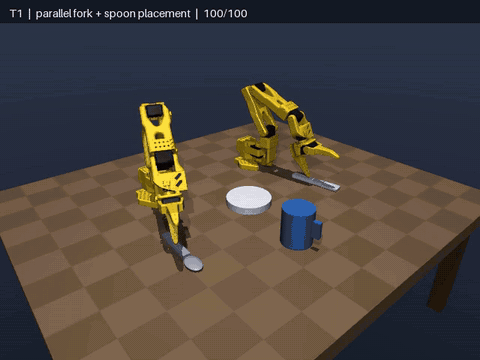

# Mise en Place

[](https://github.com/QuantumByte-01/mise-en-place-intel-bimanual/actions/workflows/tests.yml)

**LabLab AI Infra Summit — Intel track (online):** Bimanual VLA Manipulation with Multi-Modal Reasoning.

Codename for a dual **SO-101** MuJoCo dinner-table stack: image + language
planner → validated task graph → hybrid policy → OpenVINO → stress-tested execution.



*From [`artifacts/submission_demo.mp4`](artifacts/submission_demo.mp4): T1 parallel placement, T2 right-to-left spoon handoff, and the hybrid geometric-guard + INT8 learned-residual policy.*

## Implemented

- Live interactive MuJoCo viewer plus MP4/off-screen rendering
- Dual SO-101 true-parallel T1 with randomized objects and lighting
- Stable geometric baseline: **100/100 T1 randomized seeds**
- Guarded right-to-left T2 spoon handoff: **50/50 randomized seeds**
- Contact audit: zero arm-arm contacts or penetrations in 20 T1 + 50 T2 episodes
- 40 recorded expert episodes / 20,520 state-action samples
- Compact behavior-cloning student with dense pretraining then frozen-base LoRA
- FP32, FP16, NNCF static INT8, weight-only INT8 and weight-only INT4 IRs
- Repeated Torch, ONNX Runtime, OpenVINO CPU and Intel iGPU benchmarks
- Bounded learned-action executive with deterministic grasp/release guard
- Real SmolVLM2-256M image-language proposal planner with a semantic safety gate
- Counterfactual VLM grounding evaluation and deterministic fallback
- T2 transfer events and left-side placement scoring

## Quick start

```powershell
cd mise_en_place_intel_bimanual
pip install -e ".[all]"
python scripts/smoke.py
python scripts/demo_t1.py --seed 0
python scripts/eval_10seed.py --n 10
python scripts/record_demo.py --task t1 --seed 0
python scripts/record_demo.py --task t2 --seed 0
```

Artifacts land in `artifacts/`.

## Live visualization

```powershell
python scripts/live_demo.py --seed 0
python scripts/live_demo.py --task t2 --seed 0
```

The MuJoCo window is interactive: orbit/pan/zoom, inspect contacts and pause
physics from the viewer UI. The task runs at real time; use `--speed 2` for 2x.

## Train LoRA and export real INT8

```powershell
python scripts/record_demos.py --episodes 40
python scripts/train_lora_bc.py --base-epochs 40 --lora-epochs 30
python scripts/export_openvino_int8.py
python scripts/benchmark_inference_matrix.py --iterations 500 --repeats 3
python scripts/eval_hybrid_sweep.py --episodes 10
```

Repeated median measurements on this Alder Lake CPU + Intel iGPU host:

- LoRA lowered held-out action MAE from **0.01325 to 0.01227** (~7.4%).
- INT8 IR is **102,205 B** vs FP32 **142,826 B** (~28.4% smaller).
- iGPU median mean latency: FP32 **3.131 ms**, static INT8 **1.192 ms**
  (**2.63x** faster); asynchronous throughput is **1,189 vs 521 FPS** (**2.28x**).
- CPU: OpenVINO FP32 is fastest among the OpenVINO variants at **0.148 ms p50**;
  ONNX Runtime is **0.070 ms p50**. This 28k-parameter MLP is overhead-bound.
- Weight-only INT8 has much lower FP32 drift than static INT8
  (**0.00106 vs 0.01823 MAE**) but no latency win at this model size.
- Weight-only INT4 is smallest (**75,159 B**) but is slower and less accurate.
- In a matched 10-seed closed-loop sweep, static INT8 retained **10/10 at 50%**
  and **8/10 at 75%** learned authority; FP32 retained **8/10** and **2/10**.
  This suggests a quantization-induced action-regularization effect, not proof;
  the geometric executive remains the safety boundary.
- NPU is unavailable on this host. Run the same exporter on Core Ultra / Intel
  AI PC Cloud for the rubric's NPU measurement.

The learned model is a compact proprioceptive BC student that validates the
LoRA/OpenVINO pipeline. It is **not** called SmolVLA. Pure autoregressive BC
currently fails closed-loop (0/10); the reliable submitted mode uses learned
inference as a bounded residual while the geometric executive guards grasps.

## Real multimodal planner

The downloaded `HuggingFaceTB/SmolVLM2-256M-Video-Instruct` checkpoint consumes
an overhead MuJoCo frame plus a natural-language instruction. A measured
end-to-end episode produced strict task JSON, passed the object/arm/schema gate,
and completed T1 successfully without fallback:

```powershell
python scripts/download_vlm.py
python scripts/run_multimodal_episode.py --seed 1000
```

The 256M model is **not trusted for visual grounding**. It scored 50% on simple
yes/no counterfactuals by always answering "No", and failed the structured
counterfactual test. It is proposal-only; invalid or unsafe plans are rejected
before execution. This failure evidence is deliberately retained in
`artifacts/vlm_grounding_eval.json` and `artifacts/vlm_binary_eval.json`.

## Rubric map

- E2E bimanual (30): T1 parallel place → T2 handoff
- VLA reasoning (20): real SmolVLM image-language proposal + semantic gate
- OpenVINO (20): five precision modes, repeated CPU/iGPU latency and drift
- 10-seed (15): 100-seed T1 + 50-seed T2 stress artifacts
- Repro (10): this README + Makefile
- Innovation (5): measured quantization-induced stability window under bounded authority

## Layout

```
mise_en_place/
  assets/so101/          # robot MJCF
  assets/generated/      # dinner_scene.xml
  sim/                   # scene_builder, env
  control/               # IK, parallel T1, collision-free T2 handoff
  learning/              # LoRA BC student
  planner/               # rule planner + validated SmolVLM proposal planner
scripts/
docs/WIN_PLAN.md
```

## Honest submission limits

- The local host exposes CPU and Intel GPU, not NPU.
- Pure BC is not reliable closed-loop; only bounded hybrid authority is submitted.
- SmolVLM2-256M is a real multimodal model but failed grounding stress tests.
- The project should be described as **verified hierarchical multimodal
  manipulation**, not as a fully learned end-to-end foundation-model policy.

## Deadline

Submit by **Wed Sep 16, 2026 18:30 UTC** on LabLab.
